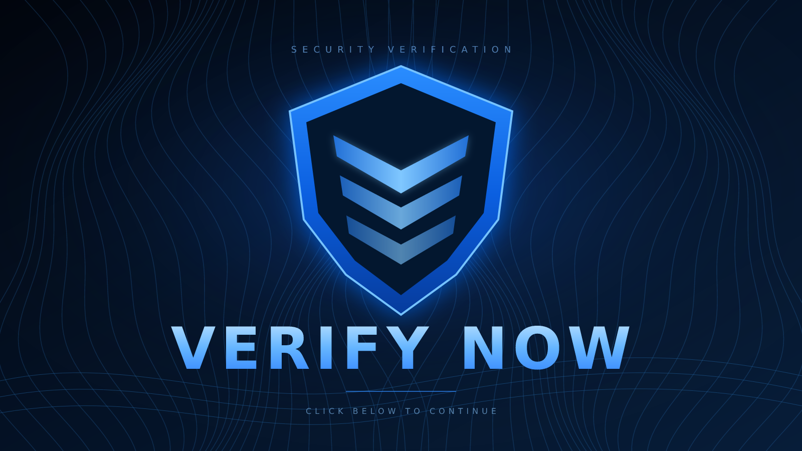

# Security — Discord verification bot

A portable Node.js Discord bot that automatically gives new members the `unverifed` role, removes it after they press **Verify**, and assigns the `member` role. It uses Discord.js v14, a normal persistent Gateway connection, and an atomic JSON configuration file. It does not depend on Cloudflare, a VPS provider, or any other hosting company.



The banner is an original local asset. It is uploaded to Discord with the panel, so the panel does not depend on a temporary image host. The shield avatar is also included.

> **24/7 operation:** a normal Node.js process must run continuously. Running `npm start` on your own computer works only while that computer is on and connected. To stay online after you turn your computer off, use an always-on host that supports long-running Node.js processes, outbound WebSocket connections, environment variables, restart-on-failure, and persistent disk storage. See [Hosting](#8-hosting-requirements) and [Docker](#9-docker-optional).

## What the bot does

1. A member joins the configured server.
2. The bot adds `unverifed` and removes `member` if it was present.
3. The member opens the verification channel and presses the blue **Verify** button.
4. The bot confirms the member is still in the server, checks the roles, adds `member`, removes `unverifed`, and verifies the final state with a fresh member fetch.
5. The bot replies privately with `You have been verified successfully!`.
6. If the account is already verified, the private reply is `You are already verified!`.

The role spelling `unverifed` is intentional and must not be corrected. The bot never creates or renames roles, and it never changes channel permissions automatically.

## Project structure

```text
security-verification-bot/
├── src/
│   ├── index.js                       # startup, event loaders, graceful shutdown
│   ├── config/config.js               # environment validation
│   ├── events/
│   │   ├── ready.js                   # startup validation and presence
│   │   ├── guildMemberAdd.js          # automatic unverifed assignment
│   │   └── interactionCreate.js       # command and button routing
│   ├── commands/
│   │   ├── setup-verification.js      # panel creation and updates
│   │   └── verification-status.js     # administrator diagnostics
│   ├── handlers/
│   │   ├── panelBuilder.js            # embed, banner and Verify button
│   │   └── verificationHandler.js     # button validation and role transition
│   ├── utils/
│   │   ├── logger.js                  # redacted logs and admin alerts
│   │   ├── retry.js                   # transient Discord/network retries
│   │   ├── roleManager.js             # hierarchy, permissions, safe transitions
│   │   ├── userLocks.js               # per-user concurrency control
│   │   └── healthServer.js            # optional generic health endpoint
│   └── storage/database.js            # atomic persistent JSON store
├── assets/
│   ├── verification-banner.png        # 1600 × 900 upload asset
│   ├── verification-banner.svg        # editable banner source
│   ├── shield-logo.png                # 512 × 512 bot avatar
│   └── shield-logo.svg                # editable logo source
├── scripts/deploy-commands.js         # guild slash-command registration
├── data/                              # generated data/config.json (ignored by Git)
├── test/                              # local automated tests
├── .env.example
├── .gitignore
├── .dockerignore
├── Dockerfile
├── package.json
└── README.md
```

## Requirements

- Node.js **20 or newer** (Node 22 is used by the Docker image).
- npm.
- A Discord server where you have **Administrator** permission.
- A Discord application and bot token.
- An always-on host for continuous operation, if you do not want to leave your computer running.

## 1. Create the Discord application and bot

1. Open the [Discord Developer Portal](https://discord.com/developers/applications) and select **New Application**. Name it `Security`.
2. On **General Information**, copy the **Application ID**. This is your `CLIENT_ID`.
3. Open **Bot**, create the bot if necessary, and use **Reset Token** to get a token. Copy it once into your private `.env` file. Do not share it, paste it into a chat, or commit it. If it is exposed, reset it immediately.
4. Still under **Bot**, enable **Server Members Intent** under **Privileged Gateway Intents**. This is required for `guildMemberAdd`. Leave **Message Content Intent** and **Presence Intent** disabled; the bot does not need them. Discord may require approval for privileged intents for larger verified applications.
5. Under **Bot**, upload `assets/shield-logo.png` as the bot avatar. The name `Security` and avatar are configured in the Developer Portal, not in the source code.
6. Open **OAuth2 → URL Generator**:
   - Scopes: `bot` and `applications.commands`.
   - Bot permissions: **View Channels**, **Send Messages**, **Embed Links**, **Attach Files**, **Read Message History**, and **Manage Roles**.
   - Open the generated URL and invite the bot to your server.
7. In Discord, enable **User Settings → Advanced → Developer Mode**. Right-click your server and choose **Copy Server ID**. This is your `GUILD_ID`.

The bot needs no Administrator permission. Manage Roles is required to add and remove the two roles.

## 2. Create the two roles

Create these roles under **Server Settings → Roles**. The names are case-sensitive:

- `unverifed` — assigned automatically when someone joins.
- `member` — assigned after successful verification.

Do not rename `unverifed` to `unverified`; the bot looks for the exact spelling used in this project.

Drag the bot's own role **above both** `unverifed` and `member`. Discord only lets a bot manage roles below its highest role. If the bot is below either role, setup and verification will fail even if the bot has Manage Roles. The roles must not be integration-managed roles.

The bot does not create or modify roles. If a role is missing or duplicated, `/verification-status` reports it and setup refuses to continue.

## 3. Configure channel permissions

Discord channel permissions are intentionally left under your control. The bot never overwrites them.

### Verification channel

Create or choose a text channel such as `#verify`.

- Give `@everyone` **View Channel** (or give `unverifed` View Channel).
- Give the bot **View Channel**, **Send Messages**, **Embed Links**, **Attach Files**, and **Read Message History**.
- If `member` should also be able to revisit the panel, allow `member` View Channel.

### Member-only channels and categories

For each regular channel or category that verified members should access:

- Deny `@everyone` **View Channel**.
- Allow `member` **View Channel**.
- Do not add an allow for `unverifed`.

This makes new members unable to see regular channels even before the join event finishes.

### Important Discord permission behavior

Discord combines role permissions. A **role allow can override another role's deny**, so a different role that grants View Channel, an Administrator role, a member-specific allow, or a public thread can accidentally give an unverified member access. Review the effective permissions with a test account rather than relying only on the role list. The bot does not audit or repair these overwrites.

## 4. Install the bot

In the project directory:

```sh
npm ci
```

If a lockfile is not available, use `npm install` instead. `npm ci` is preferred because it installs the exact versions in `package-lock.json`.

### Create your private environment file

Copy the example (Linux/macOS):

```sh
cp .env.example .env
```

Windows PowerShell:

```powershell
Copy-Item .env.example .env
```

Open `.env` in a text editor and fill in your own values:

```env
DISCORD_TOKEN=PUT_YOUR_NEW_BOT_TOKEN_HERE
CLIENT_ID=PUT_YOUR_APPLICATION_ID_HERE
GUILD_ID=PUT_YOUR_SERVER_ID_HERE
```

Use the token from the Developer Portal, the numeric Application ID, and the numeric Server ID. Do **not** include angle brackets, quotes, or extra spaces around the values.

`.env` is ignored by Git. Never commit it. The bot validates the values at startup, prints a clear error if any are missing or malformed, and never prints the token itself.

### Optional settings

| Variable | Default | Purpose |
| --- | --- | --- |
| `PORT` | disabled | Starts a read-only health endpoint on this port. Useful on hosts that require an HTTP port. |
| `DATA_FILE` | `data/config.json` | Location of the persistent JSON configuration. |
| `LOG_LEVEL` | `info` | `debug`, `info`, `warn`, or `error`. |

Example for a host that expects port `3000`:

```env
PORT=3000
```

The health endpoint is `GET /healthz` and returns only status, gateway state, and uptime. It does not expose secrets. It is not a web dashboard.

## 5. Register the slash commands

Commands are registered as **guild commands**, so they appear immediately in the configured server:

```sh
npm run deploy:commands
```

This reads `.env` locally and uses the bot token to call Discord. It registers:

- `/setup-verification`
- `/verification-status`

The script upserts these two commands and does not change other applications. If commands do not appear, run `/verification-status` after inviting the bot with the `applications.commands` scope, and confirm `GUILD_ID` is the server where you are looking.

## 6. Start the bot

```sh
npm start
```

For development with automatic restart on source changes:

```sh
npm run dev
```

A healthy startup logs:

- `Loaded slash commands`
- `Loaded gateway events`
- `Discord gateway is ready`

The bot will remain connected until the process is stopped or the host restarts it. `Ctrl+C` triggers a graceful shutdown, flushes pending configuration writes, and destroys the Discord client.

The bot itself does not make the process stay alive. On a normal computer it stops when the computer sleeps, closes the terminal, or loses its connection. Use an always-on host for continuous operation.

## 7. Configure and test verification

1. As an administrator, run `/setup-verification` and select your verification channel.
2. The bot validates both role names, role hierarchy, Manage Roles, and the channel permissions. It uploads the banner and publishes the panel. Re-running the command updates the saved panel rather than creating a duplicate.
3. Run `/verification-status`. All configured items should show green checks, and **Discord gateway** should show connected with a ping.
4. Join with a separate test account. Confirm:
   - The account receives `unverifed`.
   - It does not receive `member`.
   - It cannot see member-only channels.
   - It can see the verification channel and the panel.
5. Press **Verify**. Confirm:
   - The response is private and says `You have been verified successfully!`.
   - The account now has `member` and no `unverifed`.
   - Member-only channels are visible.
6. Press **Verify** again. Confirm the private response is `You are already verified!`.
7. Restart the bot (`Ctrl+C`, then `npm start`). The saved panel and role IDs are loaded from `data/config.json`; the existing Verify button continues to work.

Do destructive permission and missing-role tests in a separate test server, not in your live community.

## 8. Hosting requirements

To run 24/7 without your computer, choose a host that provides all of the following:

- A persistent Node.js process (not a request-only serverless function).
- Outbound HTTPS and WebSocket access to Discord.
- Environment variables or a secret manager for `DISCORD_TOKEN`.
- Automatic restart after a crash or host reboot.
- A persistent disk or volume for `data/config.json`.
- A way to run only **one** bot instance per token.

Examples of suitable categories include a small Linux VPS, a container host, or a platform that explicitly supports long-running workers. This project deliberately contains no provider-specific deployment configuration. Follow your chosen provider's instructions for:

- Setting `.env` values (or injecting the same variables).
- Mounting a persistent volume at the project's `data/` directory.
- Setting the start command to `npm start` (or `node src/index.js`).
- Enabling restart-on-failure.

> Do not run multiple replicas with the same bot token. Discord sessions compete, and duplicate gateway connections can cause inconsistent events or rate limits. This bot is designed for one process.

During a host restart, Discord.js reconnects and resumes the Gateway session when Discord allows it. Configuration survives because it is on persistent storage. Events that occurred while the bot was completely offline are **not replayed**; review members who joined during a prolonged outage manually.

## 9. Docker (optional)

Docker is optional, but it gives you a portable image and a clear place to mount persistent data.

Build:

```sh
docker build -t security-verification-bot .
```

Run with your private environment file and a named data volume:

```sh
docker run -d \
  --name security-bot \
  --restart unless-stopped \
  --env-file .env \
  -v security-bot-data:/app/data \
  security-verification-bot
```

The image runs as the non-root `node` user. The named volume keeps `data/config.json` across container replacements. View logs with:

```sh
docker logs -f security-bot
```

Stop gracefully with `docker stop security-bot`. If your host needs an HTTP health check, publish the container port and set `PORT=3000`; the included `HEALTHCHECK` uses `/healthz`.

Back up the named volume before replacing it. The configuration contains Discord IDs, not the bot token, but it is still part of your operational state.

## 10. Persistent configuration and recovery

The bot creates `data/config.json` and stores, per guild:

- Guild ID.
- Verification channel ID.
- Verification panel message ID.
- `unverifed` role ID.
- `member` role ID.
- Who configured it and when.

Writes are serialized and use a temporary file plus an atomic rename, reducing the chance of a crash leaving half-written JSON. On startup, an unreadable or invalid file produces a clear error instead of silently erasing the configuration. Restore a backup, or move the bad file aside if you intend to run `/setup-verification` again.

`data/config.json` is ignored by Git. Back it up if you rebuild the server or migrate hosts. It never contains the bot token.

## 11. Security and reliability details

- **Token handling:** loaded from `.env`; never hardcoded, printed, or written to the data file. Error formatting redacts the token from logs. `.env` is Git-ignored.
- **Least privilege:** only Guilds and Server Members intents are requested. Message Content and Presence are not requested.
- **Button validation:** only the persistent custom ID `security:verify:v1` is handled. The interaction must belong to the configured guild, the saved verification channel, and the saved panel message.
- **Duplicate clicks:** interaction IDs are deduplicated in memory, and role mutations for a user are serialized. A second click after success receives `You are already verified!`.
- **Atomic role transition:** `member` is added, `unverifed` is removed, then the member is fetched again to confirm both changes. Success is never reported before confirmation.
- **Compensation:** if a partial role change fails, the bot attempts to restore `unverifed` and remove `member`. If compensation itself fails, it logs the failure and tries to notify the server owner or system channel. Discord role updates are not transactional, so administrators should still check the member if a failure is reported.
- **Permission and hierarchy checks:** setup and status verify Manage Roles, each required channel permission, and that the bot's highest role is above both roles.
- **Temporary failures:** Discord.js handles rate limits and Gateway reconnection. The role helper retries 429, 5xx, timeout, and connection errors a limited number of times; permission errors are not retried.
- **Shutdown:** `SIGINT` and `SIGTERM` flush data and destroy the client, with a forced-exit safety timeout.
- **No public interaction endpoint:** interactions arrive through the authenticated Gateway connection. The only optional HTTP listener is the read-only health endpoint.

## 12. Troubleshooting

| Problem | Likely cause and fix |
| --- | --- |
| Startup says `DISCORD_TOKEN is missing` | Copy `.env.example` to `.env` and add the token. |
| `Used disallowed intents` or the bot disconnects with code 4014 | Enable **Server Members Intent** in the Developer Portal, then restart. |
| `Invalid token` / login fails | Reset the token, copy the complete value, remove quotes/spaces, and restart. Never post the token for help. |
| Slash commands do not appear | Run `npm run deploy:commands`, confirm the bot was invited with `applications.commands`, and verify `GUILD_ID`. |
| Setup says `The role "unverifed" does not exist` | Create the exact role name and rerun setup. |
| Setup says the bot role must be above a role | Drag the bot's role above `unverifed` and `member` under Server Settings → Roles. |
| Setup says the bot is missing permissions | Grant Manage Roles and all five channel permissions listed in section 3. |
| Verification says it is not configured | Run `/setup-verification`; an administrator must publish the panel first. |
| User verified but cannot see member channels | Check `member` role channel allows and `@everyone` denies. Discord may cache permissions; ask the user to reload Discord. |
| New member did not get `unverifed` | Confirm the bot was online, the member intent is enabled, roles still exist, and the bot is above them. If the bot was offline, fix the member manually; missed join events are not replayed. |
| Panel shows a broken image | Keep `assets/verification-banner.png` with the project. Re-run `/setup-verification` to re-upload it. |
| Duplicate panels | The saved panel is updated in place. If an orphan exists from a failed operation, delete it manually and rerun setup. |
| `Could not load persistent configuration` | The JSON file is corrupt or unreadable. Restore a backup, or move it aside and rerun setup. |
| Health check fails | Set a valid `PORT`, ensure the process is running, and request `/healthz`. A health response is not proof that Discord is connected; check `/verification-status` too. |

## 13. What was tested locally

The following checks were run locally in this project:

- `npm test`: **22 tests pass**, covering configuration validation, atomic persistence and corruption handling, role resolution and hierarchy, missing/duplicate/managed roles, join role assignment, successful verification, already-verified handling, both-roles repair, partial-failure compensation, retry classification, per-user locking, panel construction, banner validity, and command metadata.
- `npm run check`: JavaScript syntax checks pass.
- Startup with missing environment variables: exits with a clear configuration error and does not print a token.
- Banner and shield PNGs: verified as valid PNG files at 1600 × 900 and 512 × 512.

**Not tested here:** actual Discord login, Gateway connection, slash-command registration against Discord, panel upload, or real role changes. Those require your bot token, a real Discord server, and a public/always-on process. No claim is made that those live interactions were exercised.

No reference screenshot was supplied with this task, so the artwork follows the written visual brief rather than a screenshot comparison. Discord controls the embed background and button rendering; the embed's blue left accent is produced by its embed color, and the custom banner is the attached image.

## Quick command reference

```sh
npm ci                 # install exact dependencies
cp .env.example .env   # then edit .env privately
npm run deploy:commands
npm start              # run normally
npm run dev            # run with file watching during development
npm test               # local automated tests
npm run check          # syntax checks
docker build -t security-verification-bot .
```

The bot is intentionally limited to one configured guild (`GUILD_ID`). It ignores events from other servers, which keeps the configuration and permission model simple and safe.
